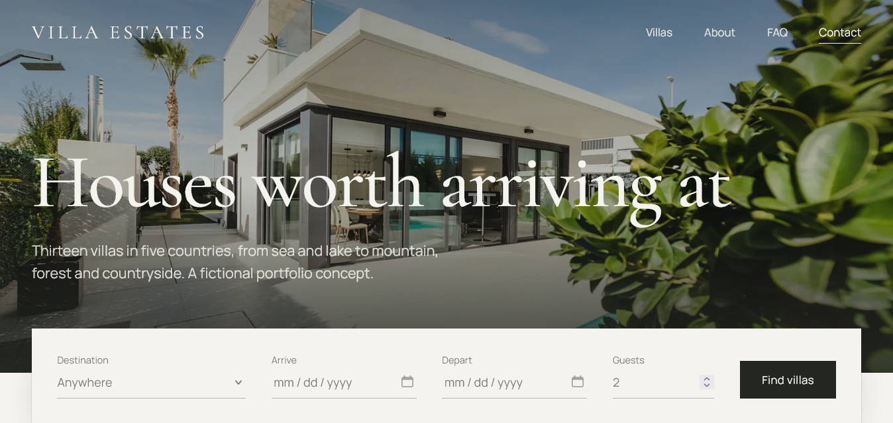

<div align="center">

# VILLA ESTATES

### Premium Villa Rental Platform

A modern villa rental platform concept focused on elegant design, curated properties and seamless booking experiences.

**Discover exceptional places. Experience meaningful stays.**


<br />
<br />



</div>

---

## Overview

VILLA ESTATES is a portfolio project demonstrating the development of a premium property rental experience.

The platform allows users to explore curated villa collections, discover property details, filter accommodation options and submit booking requests.

## Features

- Premium responsive interface
- Villa catalog and property discovery
- Dynamic property detail pages
- Search, filtering and sorting
- Interactive image galleries
- Favorites functionality
- Booking request system
- Responsive navigation
- Form validation
- Database integration

## Tech Stack

| Technology      | Purpose               |
| --------------- | --------------------- |
| Next.js         | Application framework |
| React           | UI development        |
| TypeScript      | Type safety           |
| Tailwind CSS    | Styling               |
| Supabase        | Backend and database  |
| React Hook Form | Form management       |
| Zod             | Schema validation     |

## Design Concept

The visual identity follows a luxury editorial direction:

- Warm neutral color palette
- Elegant serif typography
- Architectural photography
- Minimalist layouts
- Generous whitespace
- Refined interactions

## Getting Started

Clone the repository:

```bash
git clone YOUR_REPOSITORY_URL
cd villa-estates
```

Install dependencies:

```bash
npm install
```

Configure environment variables in `.env.local`.

Run the development server:

```bash
npm run dev
```

Open [http://localhost:3000](http://localhost:3000).

## Project Status

Portfolio / Demo Project.

All properties, prices and listings are illustrative. They do not represent verified rental offers.

## Author

Developed as a personal portfolio project.
